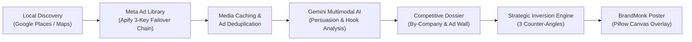
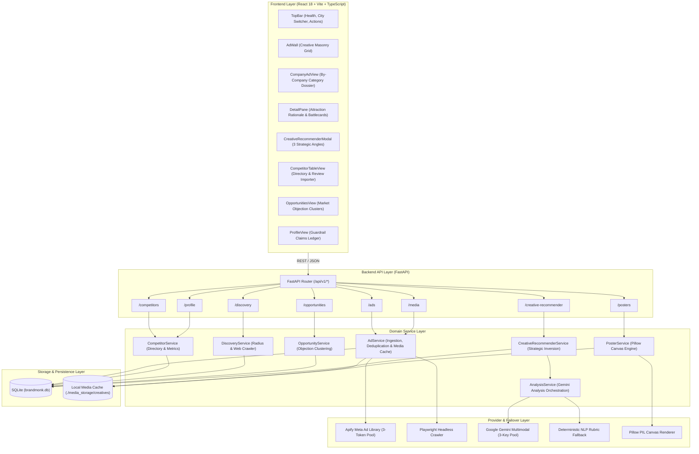

# Ad Desk — BrandMonk Competitor Ad Analyzer & Creative Recommender

> An AI-powered competitor ad intelligence platform built for **BrandMonk Academy** to discover local training institutes in Coimbatore, monitor active Facebook & Instagram campaigns via Meta Ad Library, analyze psychological persuasion hooks using Google Gemini Multimodal AI, and draft original strategic counter-posters.

---

## 1. System Overview

BrandMonk Academy offers professional industry-led courses in:
- **Artificial Intelligence (AI)**
- **Digital Marketing (DM)**
- **UI/UX Design**

To out-position regional competitors, **Ad Desk** automates the entire competitive intelligence lifecycle:



---

## 2. Working Architecture

Ad Desk is engineered using a clean, layered architectural pattern: **Presentation $\rightarrow$ Routing $\rightarrow$ Domain Services $\rightarrow$ Provider Protocols $\rightarrow$ Persistence**.



### End-to-End Operational Flow

1. **Competitor Discovery Pipeline**: The discovery engine (`DiscoveryService`) crawls local directories within a specified radius (e.g., 10 km around Coimbatore), identifies institutes teaching AI, DM, or UI/UX, extracts their official Facebook Page IDs and Instagram handles, and registers them in the database.
2. **Meta Ad Scraping with 3-Token Failover**: `AdService` passes competitor Page IDs to Apify's `jaybird~meta-ad-library-scraper` actor. If token #1 encounters rate limits or expires, the system automatically rotates to token #2 or #3 without user disruption. If Apify is unavailable, it steps down to ScrapeCreators, Playwright, or manual import.
3. **Local Media Caching (Ephemeral CDN Solution)**: Meta Ad Library media URLs expire within 24–48 hours. When an ad is ingested, the backend downloads the creative stream, computes its SHA-256 hash, and saves it in `./media_storage/creatives/{hash}.jpg`. Ads permanently serve local proxy links (`/api/v1/media/{hash}`).
4. **Multimodal AI Persuasion Analysis**: Every ad is analyzed using Google Gemini 2.5/3.5 with key rotation. The model inspects both visual media and copy text within a prompt-injection quarantine (`<<<UNTRUSTED_AD_COPY>>>`), returning structured JSON: creative score, hook, offer, audience persona, tactics, and **why the ad is attractive**. If Gemini is offline, a deterministic NLP rubric scores the ad automatically.
5. **Categorized Market Intelligence**:
   - **Ad Wall**: A masonry gallery of authentic creatives, sortable by running duration, creative score, or course.
   - **By Company View**: Grouped institutional dossiers showing every ad run by each competitor, active days, and marketing battlecards.
6. **Strategic Inversion & Approved Claims Guardrail**: `CreativeRecommenderService` generates 3 counter-angles (Contrarian Pattern Interrupt, Verified Proof & Live ROI, Friction-Free Transparency). The AI is **strictly restricted** to verified BrandMonk claims from the business profile.
7. **Social Poster Generation**: `PillowPosterRenderer` applies BrandMonk brand styles (Navy `#16202E`, Blue `#1F4FD8`, Sun `#F2B84B`), text safe zones, and typography hierarchy to render downloadable social creatives (Feed 4:5, Square 1:1, Story 9:16).

---

## 3. Core Capabilities

- **Automated Competitor Discovery**: Identifies institutes within a customizable radius (e.g., 10 km in Coimbatore) and resolves official Facebook Page IDs and Instagram handles.
- **Resilient Ad Scraping Chain**: Scrapes active Meta ads using Apify with a 3-token automatic rotation pool, falling back to ScrapeCreators, local Playwright headless scraping, and manual import.
- **Media Preservation**: Automatically caches Meta ad creatives (images and video thumbnails) locally with SHA-256 content hashing to prevent dead links caused by ephemeral Meta CDN expiration.
- **Gemini Multimodal Analysis**: Dissects ad creatives into structured strategic metrics:
  - Creative effectiveness score (0–100)
  - Core attention hook & offer anchor
  - Target audience persona & psychological mindset
  - Persuasion tactics (Scarcity, Fixed timeline, Practical proof, Placement guarantee)
  - **Why this advertisement is attractive** (unpacks prospect psychology)
  - Competitor vulnerabilities (hidden fees, vague syllabus, missing salary proofs)
- **By-Company Category Dossier**: Allows users to view all active and historical ads grouped under each competitor company (Nexora Academy, Growth Lab, Lumen Design School, CodeBridge Institute, Pixel & Pen Institute, Skillhub Tech).
- **Approved Claims Guardrail**: Enforces strict brand safety. The AI counter-generator is physically restricted to verified BrandMonk claims (e.g. *100% upfront fee transparency*, *working practitioner mentors*).
- **BrandMonk Poster Studio**: Generates clean AI image prompts and renders brand-compliant social posters (Feed 4:5, Square 1:1, Story 9:16) with text safe zones.

---

## 4. Quick Start Guide

### Prerequisites
- Python 3.11+ (recommended: Python 3.12 or 3.14)
- Node.js 18+ and npm
- `uv` (Fast Python package manager) or standard `pip`

---

### Step 1: Environment Configuration

Create a `.env` file in the project root:

```bash
cp .env.example .env
```

Populate the required credentials:

```env
# Server
ENVIRONMENT=development
HOST=0.0.0.0
PORT=8000
ALLOWED_ORIGINS=http://localhost:5173,http://localhost:3000,http://127.0.0.1:5173

# Database & Media Storage
DATABASE_URL=sqlite:///./brandmonk.db
MEDIA_STORAGE_DIR=./media_storage

# Scraping Limits & Timeouts
MONTHLY_COST_CAP_USD=10.0
SCRAPE_TIMEOUT_SECONDS=35

# Meta Ad Library Scraper - Apify (Multi-token Failover Pool)
APIFY_API_TOKEN=your_primary_apify_token
APIFY_API_TOKEN_2=your_backup_apify_token_2
APIFY_API_TOKEN_3=your_backup_apify_token_3
APIFY_META_ACTOR_ID=jaybird~meta-ad-library-scraper
APIFY_MAPS_ACTOR_ID=compass/crawler-google-places

# Multimodal AI Ad Analysis - Google Gemini (Multi-key Failover Pool)
GEMINI_API_KEY=your_primary_gemini_api_key
GEMINI_API_KEY_2=your_backup_gemini_api_key_2
GEMINI_API_KEY_3=your_backup_gemini_api_key_3
```

---

### Step 2: Start the Backend API

Using `uv` (recommended):
```bash
cd backend
uv sync
uv run python run.py
```

Using standard `venv` & `pip`:
```bash
cd backend
python -m venv .venv
source .venv/bin/activate  # On Windows: .venv\Scripts\activate
pip install -r requirements.txt
python run.py
```

- API Base URL: `http://127.0.0.1:8000`
- Interactive OpenAPI Docs: `http://127.0.0.1:8000/docs`

---

### Step 3: Start the Frontend Interface

In a separate terminal:
```bash
cd frontend
npm install
npm run dev
```

- Web Interface: `http://127.0.0.1:5173`

---

### Step 4: Run Tests

Execute the automated backend test suite:
```bash
cd backend
uv run pytest tests/ -v
```

Execute frontend type-checking and production build:
```bash
cd frontend
npm run build
```

---

## 5. Primary Web Views

| View Tab | Purpose |
|---|---|
| **Ad Wall** | Masonry grid of authentic Meta ad creatives, course filters (AI, Digital marketing, UI/UX), running duration indicators, and direct preview links. |
| **By Company** | Category view grouping active ads under each competitor institution with complete intelligence dossiers, longevity metrics, and direct counter-ad actions. |
| **Competitors** | Management directory displaying tracked training institutes, geographical distance, Meta Page IDs, and live tracking status. |
| **Opportunities** | Market-wide objection cluster engine surfacing recurring prospect hesitations across all competitor ads with pre-drafted counter-angles. |
| **Profile** | BrandMonk business profile, service catalog, service radius settings, and approved brand claims guardrail. |

---

## 6. Technology Stack

- **Backend**: FastAPI, Pydantic v2, SQLAlchemy 2, SQLite, HTTPX, Pillow, UV
- **Ad Collection**: Apify Meta Ad Library Scraper actor (`jaybird/meta-ad-library-scraper`), ScrapeCreators, Playwright
- **AI Analysis**: Google Gemini 2.5/3.5 Multimodal API with deterministic NLP rubric fallback
- **Frontend**: React 18, Vite, TypeScript, Pure CSS Design System tokens (BrandMonk Light Theme)
- **Quality Assurance**: Pytest, Playwright MCP end-to-end browser testing

---

For in-depth architectural specifications, sequence diagrams, and provider failure contracts, refer to [PROJECT_DOCUMENTATION.md](PROJECT_DOCUMENTATION.md).
